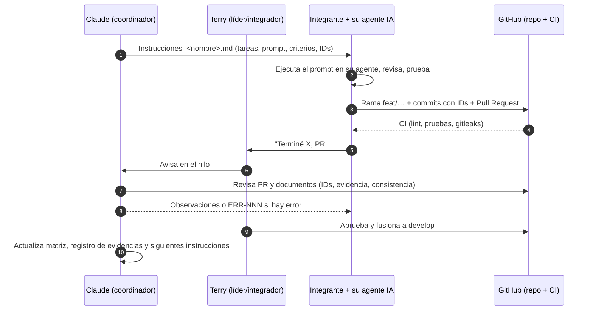

# Metodología de trabajo — Proyecto Final (Sistema de Misión Crítica)

Versión: v1 · Fecha: 2026-11-11 · Autor: Claude (coordinador) para Terry · Estado: Propuesta (pendiente de aprobación del equipo)

## 1. Idea central

Repetimos el modelo del primer parcial, ajustado a un proyecto que **construye software**:

1. **Claude (coordinador)** prepara por etapa un archivo `Instrucciones_<nombre>.md` para cada integrante, con contexto, tareas, prompt listo para su agente de IA, criterios de aceptación y qué entregar.
2. **Cada integrante** ejecuta su parte con **su propio agente de IA** (Claude Code, Copilot, ChatGPT, etc.) en su rama del repositorio, **revisa y entiende** lo que el agente produjo, lo ejecuta y obtiene la evidencia.
3. **La integración** se hace por Pull Request: el CI corre, otro integrante revisa, Terry (integrador) aprueba y fusiona. Claude valida los documentos y evidencias antes de que entren a la versión oficial.
4. **Los errores son parte del proyecto.** Cada error (del agente, humano, de integración o de especificación) se registra como `ERR-NNN` con su causa y lección. Esto no es un adorno: alimenta las métricas (Fase 9 del enunciado) y la comparación Cleanroom vs. detección-corrección (Fase 3).

Por qué funciona: el enunciado no evalúa "que no haya errores", evalúa que **cada cambio esté controlado y cada afirmación tenga evidencia**. Un error detectado, registrado y corregido con su RFC/commit/prueba es evidencia de un proceso que funciona.

## 2. Roles y reparto (4 personas)

El reparto sigue los perfiles del primer parcial (Germán y Neyls instalaron y ejecutaron entornos; Juan llevó RF y pruebas; Terry lideró, integró la matriz y el informe) y añade el código. **Todos programan algo** y **todos son dueños de al menos un expediente formal**, porque la defensa puede ser individual.

| Persona | Rol principal | Código que construye (con su agente) | Expedientes/entregables que lidera | Rol Cleanroom |
|---|---|---|---|---|
| **Terry** | Líder, Gestor de Configuración (preside el CCB), integrador de Git | Script de métricas y tablero de indicadores (RF-12); fusiones, tags y releases | E07 Plan GC, E08 Inventario CI y líneas base, E09 Repositorio/versionamiento, E10 Cambios, E12 RFC MFA (impacto y decisión), E13 Métricas, E14 Matriz maestra, E15 Certificación, informe final | Equipo de **certificación** (prueba estadística de uso, estimación de confiabilidad) |
| **Germán** | Backend, base de datos e infraestructura | API (capas controlador-servicio-repositorio), modelo de datos y migraciones, Docker, CI, logging, auditoría (RF-10), backups | E01 (arquitectura y modelo de datos), E03 Confiabilidad (MTTF/MTTR/MTBF, inyección de fallos, recuperación), pruebas de rendimiento y recuperación | Equipo de **desarrollo** (implementa los incrementos del módulo crítico) |
| **Neyls** | Seguridad y app móvil | App móvil (login, 2 procesos del dominio, manejo de conectividad), autenticación/autorización en API, **MFA** (Etapa 7) | E02 Seguridad (matrices de amenazas y por etapa), E06 Modelo formal y verificación, pruebas de seguridad y móviles | Equipo de **verificación** (verificación de corrección contra el modelo) |
| **Juan** | Requisitos, especificación y web | App web (procesos de negocio, validaciones, búsqueda, notificaciones) | E01 (catálogo RF/RNF y criterios de aceptación), E04 Cleanroom (expediente), E05 Especificación formal, E11 Requisito contradictorio, pruebas funcionales/aceptación/regresión web | Equipo de **especificación** (estructuras de caja del módulo crítico) |

### 2.1 Por qué este reparto

- **Separación de responsabilidades que el propio enunciado premia:** quien especifica (Juan) no es quien implementa (Germán) ni quien verifica (Neyls) ni quien certifica (Terry). Eso es literalmente la organización de equipos de Cleanroom, y es defendible en la auditoría.
- **Seguridad y móvil juntos (Neyls):** el MFA y el control de sesión tocan la app móvil y la API; un solo dueño evita que el cambio de emergencia quede partido.
- **Backend y confiabilidad juntos (Germán):** MTTF/MTTR salen de inyectar fallos al backend y la BD, que él controla.
- **Web y requisitos juntos (Juan):** las pruebas de aceptación web son la forma más directa de demostrar sus criterios de aceptación.
- **Terry sin un front completo:** coordina con Claude, integra Git y cierra la matriz y el informe; su código (métricas/tablero) está ligado a su entregable E13.

### 2.2 Carga estimada (unidades relativas)

| Persona | Construcción | Expedientes | Total aprox. |
|---|---|---|---|
| Terry | 15 % | 85 % | 100 |
| Germán | 60 % | 40 % | 100 |
| Neyls | 50 % | 50 % | 100 |
| Juan | 45 % | 55 % | 100 |

Si alguien queda sobrecargado en una etapa, la regla es mover **tareas completas** (no medias tareas) y registrarlo en el acta.

### 2.3 RACI por etapa (R = responsable, A = aprueba, C = consultado, I = informado)

| Etapa | Terry | Germán | Neyls | Juan |
|---|---|---|---|---|
| 0 Arranque y gobernanza | R/A | C (repo, CI) | C | C |
| 1 Requisitos, arquitectura y datos | A | R (arquitectura, BD) | C | R (catálogo RF/RNF) |
| 2 Riesgos: seguridad y confiabilidad | A | R (fallos) | R (amenazas) | C |
| 3 Especificación, modelo y plan Cleanroom | A | C | R (modelo) | R (especificación) |
| 4 Construcción incremental | R (integración) | R (API/BD) | R (móvil, auth) | R (web) |
| 5 Incidente: requisito contradictorio | A | I | R (modelo) | R (especificación) |
| 6 Verificación y línea base v1.0.0 | R/A (certificación) | R (rendimiento, recuperación) | R (seguridad, móvil) | R (funcional, aceptación) |
| 7 Cambio de emergencia MFA | R/A (CCB, impacto) | R (regresión, disponibilidad) | R (implementa MFA) | R (web, especificación) |
| 8 Evidencia, métricas y dictamen | R/A | C | C | C |
| 9 Informe y defensa | R | R | R | R |

## 3. Ciclo de trabajo por bloque



Reglas del ciclo:

1. **Un bloque = un objetivo verificable** (p. ej. "endpoint de prescripción con pruebas unitarias en verde"). Al cerrar el bloque se avisa a Terry en una línea: qué quedó hecho y qué no.
2. **Instrucciones solo de la etapa en curso.** Las anteriores pasan a `99_Archivo/`.
3. **Si te bloqueas más de 30 min**, avisas a Terry; se pasa a la siguiente tarea propia que no dependa del bloqueo.
4. **Nada entra a `main` sin PR, CI verde y revisión.** Nadie hace `push` directo a `main` ni a `develop`.

## 4. Cómo usar el agente de IA personal

### 4.1 Reglas compartidas para todos los agentes

El repositorio trae `AGENTS.md` (y `CLAUDE.md`, que apunta a él). Cualquier agente que abra el repo lee esas reglas. Resumen:

1. **Cero invención:** el agente no inventa datos, cifras, resultados de prueba ni evidencias. Si falta un dato escribe `Sin dato` y quién lo aporta.
2. **IDs siempre:** todo commit, prueba, especificación y documento cita los IDs que toca (`RF-004`, `RSK-007`, `TC-021`…). Ver `Convencion_IDs_v1.md`.
3. **Sin secretos:** nunca escribir contraseñas, tokens ni `.env` reales; solo `.env.example`.
4. **Pruebas con el código:** toda función de una regla de negocio llega con su prueba unitaria.
5. **El agente propone, la persona decide:** el integrante debe poder explicar cada línea que entrega (habrá defensa individual).
6. **No tocar lo que no es tuyo:** cada carpeta tiene dueño (`CODEOWNERS`). Si el agente necesita cambiar algo ajeno, se abre un issue y se coordina.

### 4.2 Plantilla de prompt

La plantilla completa está en `00_Gobernanza/Plantillas/Plantilla_Prompt_Agente.md`. Estructura:

```
[ROL] Eres el agente de <nombre>, responsable de <rol> en el proyecto <sistema>.
[CONTEXTO] Lee AGENTS.md, docs/01_sistema/requisitos.md y <archivos de entrada>.
[TAREA] <una tarea verificable> para los IDs <RF-xxx, RSK-xxx>.
[RESTRICCIONES] Stack <…>; no modificar <carpetas ajenas>; sin secretos; sin inventar datos.
[CRITERIOS DE ACEPTACIÓN] <lista comprobable: pruebas, comandos, salidas esperadas>.
[ENTREGA] Archivos en <rutas>; commit "tipo(ámbito): descripción [IDs]"; resumen de lo hecho,
          lo que NO pudiste verificar y dudas abiertas.
```

El último punto ("lo que NO pudiste verificar") es obligatorio: es la fuente principal de `ERR-NNN` y de riesgos residuales.

## 5. Errores y lecciones (parte del proyecto)

| Tipo | Qué es | Dónde se registra | Ejemplo |
|---|---|---|---|
| `ERR-NNN` | Error de proceso: lo cometió un agente, una persona, la integración o la especificación | `docs/14_errores_lecciones/Registro_Errores.md` (repo) | El agente generó un endpoint sin verificar el rol en el servidor |
| `DEF-NNN` | Defecto del producto (llegó al código/versión) | Issues de GitHub con etiqueta `defecto` + hoja de la matriz | Se puede administrar dos veces la misma dosis |
| `LEC-NNN` | Lección aprendida que cambia una regla o plantilla | Mismo registro, columna "Lección" | "Pedir al agente la prueba de autorización negativa en el mismo prompt" |

Cada `ERR` registra: etapa donde se **inyectó**, etapa donde se **detectó**, origen (agente / humano / integración / especificación), artefacto afectado, cómo se detectó (revisión, CI, prueba, modelo), corrección (commit/PR) y lección.

Uso posterior:

- **Métricas:** eficiencia de eliminación de defectos por etapa, defectos escapados a `v1.0.0`, % de errores de origen agente.
- **Cleanroom:** compara los defectos del módulo crítico (construido con prevención) contra los del resto del sistema (detección y corrección). Es la evidencia cuantitativa del análisis comparativo de la Fase 3.

## 6. Git y gestión de configuración (resumen operativo)

Detalle formal en el Plan de GC (E07, Etapa 0–1). Lo mínimo para empezar:

| Elemento | Regla |
|---|---|
| Ramas | `main` (solo líneas base y releases, protegida) · `develop` (integración) · `feat/<ID>-desc` · `fix/DEF-NNN-desc` · `docs/<ID>-desc` · `rfc/RFC-NNN-desc` (cambio de emergencia, sale del tag `v1.0.0`) |
| Commits | Conventional Commits + IDs: `feat(api): registrar administración de dosis [RF-006][RSK-004]` |
| PR | Plantilla obligatoria (IDs, pruebas, evidencia, riesgo). 1 revisión de otra persona + CI verde |
| Tags | `lb-req-1.0` (requisitos), `lb-esp-1.0` (especificación/modelo), `v1.0.0` (**línea base previa al cambio**), `v1.1.0` (**línea base posterior al MFA**) |
| Conflicto controlado | Planificado en la Etapa 4: Juan y Neyls modifican el catálogo de roles/permisos compartido en ramas distintas; se documenta el conflicto, la resolución y la prueba (exigido por la Fase 7) |
| Matrices Excel | Se editan en Excel para la web (como en el parcial). En cada línea base se exporta una copia a `docs/11_matrices/<tag>/` y se versiona |
| Evidencias | En `evidencias/<TIPO>/` del repo, con el tag de la versión en el nombre. Las sube Claude/Terry tras validarlas (los integrantes las dejan en `02_Equipo/<nombre>/Entregas/Evidencias/`) |
| Secretos | `.env` en `.gitignore`; `gitleaks` en el CI |

## 7. Comunicación y control

- **Canal:** WhatsApp para avisos; decisiones que importan quedan en un acta `ACT-NNN` o en un RFC.
- **Seguimiento:** una línea al cierre de cada bloque; acta corta al cierre de cada etapa (hito).
- **CCB (comité de control de cambios):** Terry (preside) + dueño del artefacto afectado + uno más. Decide RFC: aceptar / rechazar / aplazar, con acta.
- **Definición de "hecho"** para cualquier tarea: código/documento en el repo vía PR, IDs citados, prueba o verificación ejecutada sobre la versión indicada, evidencia registrada.

## 8. Riesgos del propio proyecto

| Riesgo | Mitigación |
|---|---|
| Los agentes generan código inconsistente entre web, móvil y API | Contrato único (OpenAPI + esquemas compartidos en `packages/shared`) que Germán publica en la Etapa 1 antes de que nadie programe pantallas |
| Alguien no domina Git | Etapa 0 incluye una práctica guiada (clonar, rama, PR); Terry integra |
| Retraso en el backend bloquea web y móvil | Web y móvil arrancan contra un mock generado del OpenAPI |
| Datos de confiabilidad insuficientes | Inyección de fallos controlada y ventana de medición definida en la Etapa 2 |
| Un integrante no puede defender lo que hizo su agente | Cada entrega incluye "qué hace y por qué" en 5 líneas escritas por la persona; ensayo de defensa en la Etapa 9 |
| Se pisan Excel/documentos | Dueño por hoja/carpeta; Excel solo en el navegador; documentos oficiales solo por PR |
