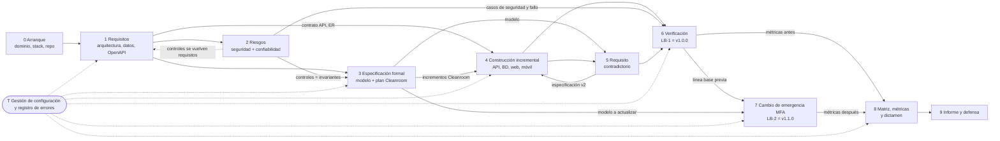
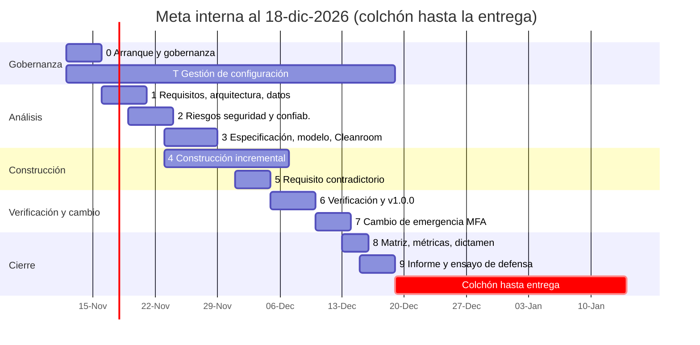
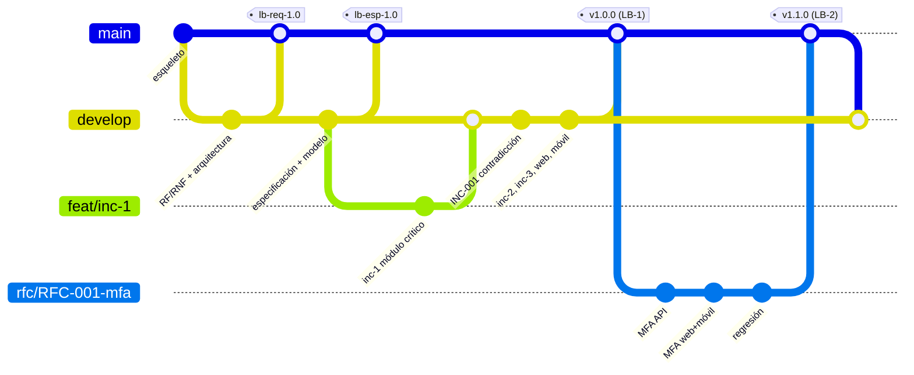

# Plan por etapas — Proyecto Final (Sistema de Misión Crítica)

Versión: v1 · Fecha: 2026-11-11 · Estado: Propuesta · Versión visual: `Guia_Visual_Plan_v1.html`

Los diagramas usan Mermaid: se ven en GitHub, VS Code (extensión Markdown Preview Mermaid) o en la guía HTML.

## 1. Por qué etapas propias y no las 10 fases del enunciado

Las 10 fases del enunciado son **análisis** (seguridad, confiabilidad, Cleanroom, formalización…). Pero el sistema hay que **construirlo**, y los análisis necesitan cosas que solo existen en cierto momento:

- No se puede calcular MTTF/MTTR sin un sistema corriendo (Fase 2 necesita código).
- No se puede hacer Cleanroom después de programar el módulo: Cleanroom **es** la forma de programarlo (Fase 3 va antes y durante la construcción).
- El cambio de emergencia (Fase 8) exige una línea base previa: tiene que existir `v1.0.0` verificada.
- Las métricas "antes y después" (Fase 9) necesitan medir dos veces.

Por eso se reorganizan en **10 etapas (0–9)** que construyen y analizan a la vez. Cada etapa produce entradas para las siguientes; la gestión de configuración (Fases 6–7) es **transversal** desde el día 1.

## 2. Etapas

| Etapa | Nombre | Objetivo | Produce (entra a…) | Hito / línea base |
|---|---|---|---|---|
| **0** | Arranque y gobernanza | Decidir dominio y stack, crear repo, reglas, roles | Repo con esqueleto, convención de IDs, Plan GC v0 (→ todas) | **H0** repo creado |
| **1** | Requisitos, arquitectura y datos | Catálogo RF/RNF con IDs y criterios de aceptación; 5 procesos de negocio; proceso crítico; arquitectura; modelo ER; contrato OpenAPI | Requisitos (→2, 3, 4), arquitectura y contrato (→4) | **LB-REQ** tag `lb-req-1.0` |
| **2** | Riesgos: seguridad y confiabilidad por diseño | Activos, amenazas, vulnerabilidades, riesgos, controles; escenarios de fallo; objetivo de disponibilidad; plan de inyección de fallos | Controles que se vuelven requisitos (→1), invariantes (→3), pruebas de seguridad y fallo (→6) | — |
| **3** | Especificación formal, modelo y plan Cleanroom | Formalizar ≥3 requisitos críticos; modelo de estados del módulo crítico; verificar propiedades; planificar incrementos Cleanroom | Especificación y modelo (→4, 5, 7), plan de incrementos (→4) | **LB-ESP** tag `lb-esp-1.0` |
| **4** | Construcción incremental | API + BD + web + móvil; módulo crítico por incrementos Cleanroom; resto con ciclo normal; CI, logging, auditoría; conflicto de integración controlado | Sistema funcional (→5, 6), datos de defectos (→8) | Incrementos `inc-1`, `inc-2`, `inc-3` |
| **5** | Incidente: requisito contradictorio | Analizar el requisito nuevo contra invariantes; demostrar coexistencia o contradicción **con el modelo** | Especificación/modelo v2 (→6, 7), INC-001 (→8) | Actualiza **LB-ESP** → `lb-esp-1.1` |
| **6** | Verificación y línea base previa | Pruebas de todos los tipos, certificación Cleanroom, medición de confiabilidad, métricas "antes" | Resultados de prueba y métricas v1.0.0 (→7, 8) | **LB-1** tag `v1.0.0` |
| **7** | Cambio de emergencia (MFA) | RFC → impacto → CCB → cambio → verificación → regresión → métricas "después" | v1.1.0, expediente RFC-001 (→8) | **LB-2** tag `v1.1.0` |
| **8** | Evidencia, métricas y dictamen | Cerrar matriz maestra, detectar huecos, comparar antes/después, dictamen técnico | Matriz y certificación (→9) | **H8** dictamen |
| **9** | Informe y defensa | Informe de 18 secciones, guías de defensa individuales, ensayo de auditoría | Entrega final | **H9** entrega |
| **T** | Transversal: Gestión de configuración y errores | Ramas, PR, tags, inventario CI, registro ERR/DEF, matriz incremental | Todo | En cada hito |

## 3. Dependencias entre etapas

Lectura: la flecha punteada 2 → 1 es un ciclo intencional. El análisis de riesgos agrega requisitos (por ejemplo "bloqueo tras 5 intentos fallidos") **antes** de congelar `lb-req-1.0`.

### 3.1 Qué alimenta a qué (N → N+1, N+2, N+3)

| Etapa | Alimenta a N+1 | Alimenta a N+2 / N+3 | Si se retrasa… |
|---|---|---|---|
| 1 | 2: los activos salen de los datos y procesos | 3: requisitos críticos a formalizar; 4: contrato API | Nadie puede programar con contrato estable |
| 2 | 3: cada control crítico se escribe como invariante o precondición | 6: pruebas de seguridad y de fallo; 8: fila Riesgo/Control de la matriz | Las pruebas de seguridad quedan sin riesgo que las justifique |
| 3 | 4: el módulo crítico se implementa contra la especificación | 5: el modelo es la herramienta para decidir la contradicción; 7: el MFA modifica el modelo | La contradicción se "decide por opinión" (el enunciado lo invalida) |
| 4 | 5: el requisito nuevo llega sobre código real | 6: hay algo que probar y medir | Todo lo demás se corre |
| 6 | 7: sin `v1.0.0` no hay "línea base previa" | 8: métricas "antes" | El cambio de emergencia no es controlado |
| 7 | 8: métricas "después" y evidencia de regresión | 9: sección de incidentes del informe | No se puede demostrar "qué cambió y qué permaneció" |

## 4. Calendario tentativo

**Fechas:** entrega oficial en 64 días (≈ 2027-01-14). Meta interna: terminar el 2026-12-18 con al menos 90 % listo; del 19-dic al 14-ene queda como colchón para correcciones, ensayo de defensa y imprevistos. El calendario se ajusta si el docente cambia la fecha.

Las etapas 2, 3 y 4 se solapan a propósito: mientras Juan y Neyls formalizan el módulo crítico, Germán levanta la infraestructura y los módulos no críticos.

## 5. Líneas base

| Línea base | Tag | Qué congela | Criterio de aprobación |
|---|---|---|---|
| LB-REQ | `lb-req-1.0` | Catálogo RF/RNF, criterios de aceptación, arquitectura, ER, OpenAPI v1 | Todo RF/RNF con ID, criterio de aceptación y dueño; revisión de los 4 |
| LB-ESP | `lb-esp-1.0` → `1.1` tras INC-001 | Especificación formal, modelo y resultados de verificación | Todas las propiedades verificadas o con contraejemplo documentado |
| **LB-1** (previa al cambio) | `v1.0.0` | Código, BD, pruebas, resultados, métricas "antes", matrices exportadas | CI verde; casos críticos ejecutados sobre `v1.0.0`; evidencia registrada |
| **LB-2** (posterior al cambio) | `v1.1.0` | Todo lo anterior + RFC-001 implementado, regresión, métricas "después" | RFC aprobado; regresión completa en verde; disponibilidad ≥ objetivo |

"Demostrar qué cambió y qué permaneció": `git diff v1.0.0 v1.1.0 --stat` + matriz de impacto del RFC + regresión de los requisitos no afectados.

## 6. Mapeo con el enunciado

### 6.1 Fases del enunciado → etapas propias

| Fase del enunciado | Etapas donde se trabaja | Etapa donde se cierra |
|---|---|---|
| 1 Ingeniería de seguridad | 2 (análisis), 4 (controles), 6 (pruebas) | 6 |
| 2 Ingeniería de confiabilidad | 2 (escenarios), 6 (medición) | 6 (y comparación en 8) |
| 3 Cleanroom | 3 (especificación y plan), 4 (incrementos), 6 (certificación) | 6 |
| 4 Formalización | 3, 5 | 5 |
| 5 Modelado y verificación | 3, 5, 7 | 7 |
| 6 Gestión de configuración | T, 0, 1 | 7 |
| 7 Repositorio y cambios | T, 4 (conflicto controlado) | 7 |
| 8 Cambio de emergencia | 7 | 7 |
| 9 Métricas | 2 (definición), 6 (antes), 7 (después) | 8 |
| 10 Matriz de evidencia | 1 → 8 (se llena por filas) | 8 |

### 6.2 Entregables (E01–E16) → etapa, carpeta del repo y responsable

| ID | Entregable | Etapa de cierre | Carpeta en el repo | Responsable |
|---|---|---|---|---|
| E01 | Expediente técnico del sistema | 1 (actualiza en 6) | `docs/01_sistema/` | Juan + Germán |
| E02 | Modelo de activos, amenazas, vulnerabilidades, riesgos y controles | 2 (evidencia en 6) | `docs/02_seguridad/` | Neyls |
| E03 | Informe cuantitativo de confiabilidad | 6 | `docs/03_confiabilidad/` | Germán |
| E04 | Expediente Cleanroom | 6 | `docs/04_cleanroom/` | Juan (con los 4 equipos) |
| E05 | Especificaciones formales | 3 (v2 en 5) | `docs/05_especificacion/` | Juan |
| E06 | Modelo formal y expediente de verificación | 3 (actualiza en 5 y 7) | `docs/06_modelo_verificacion/` | Neyls |
| E07 | Plan de Gestión de Configuración | 1 | `docs/07_configuracion/` | Terry |
| E08 | Inventario de CI y líneas base | 7 | `docs/07_configuracion/` | Terry |
| E09 | Repositorio y evidencias de versionamiento | 7 | `docs/08_versionamiento/` | Terry |
| E10 | Expediente de solicitudes y decisiones de cambio | 7 | `docs/09_cambios/` | Terry |
| E11 | Informe del requisito contradictorio | 5 | `docs/09_cambios/INC-001/` | Juan + Neyls |
| E12 | Informe de impacto y tratamiento del cambio de emergencia | 7 | `docs/09_cambios/RFC-001/` | Terry + Neyls |
| E13 | Catálogo, cálculo e interpretación de métricas | 8 | `docs/10_metricas/` | Terry |
| E14 | Matriz maestra de trazabilidad y evidencias | 8 | `docs/11_matrices/` | Terry |
| E15 | Informe técnico final de certificación | 8 | `docs/13_certificacion/` | Terry |
| E16 | Defensa | 9 | `03_Informe_Defensa/` (OneDrive) | Los 4 |

### 6.3 Informe final (18 secciones) → de dónde sale cada una

| # | Sección del informe | Fuente | Etapa |
|---|---|---|---|
| 1 | Portada e identificación del equipo | Gobernanza | 9 |
| 2 | Resumen ejecutivo | E15 | 9 |
| 3 | Descripción del sistema y criticidad | E01 | 1 |
| 4 | Requisitos y arquitectura | E01 | 1 |
| 5 | Ingeniería de seguridad | E02 | 2, 6 |
| 6 | Análisis de confiabilidad | E03 | 6 |
| 7 | Aplicación de Cleanroom | E04 | 3, 4, 6 |
| 8 | Especificación funcional/formal | E05 | 3, 5 |
| 9 | Modelado y verificación | E06 | 3, 5, 7 |
| 10 | Gestión de configuración y líneas base | E07, E08 | T, 7 |
| 11 | Repositorio y control de versiones | E09 | T, 7 |
| 12 | Gestión de cambios | E10 | 7 |
| 13 | Métricas e indicadores | E13 | 8 |
| 14 | Matriz de trazabilidad | E14 | 8 |
| 15 | Incidentes y cambios impuestos | E11, E12 | 5, 7 |
| 16 | Dictamen técnico final | E15 | 8 |
| 17 | Conclusiones | — | 9 |
| 18 | Anexos y evidencias | `evidencias/` | 9 |

## 7. Matriz obligatoria: cómo se va llenando

| Columna | Se llena en la etapa | Quién |
|---|---|---|
| REQ | 1 | Juan |
| Riesgo | 2 | Neyls / Germán |
| Control | 2 (diseño) → 4 (implementado) | Neyls |
| Especificación | 3 | Juan |
| Modelo | 3 | Neyls |
| Prueba | 4 (diseño) → 6 (ejecución) | Juan / Neyls / Germán |
| CI/Versión | 6 (`v1.0.0`) y 7 (`v1.1.0`) | Terry |
| Métrica | 6–8 | Terry |
| Evidencia | 4–8 | Claude valida, Terry registra |

Regla del enunciado: una fila crítica sin evidencia verificable = requisito **no demostrado**. En la Etapa 8 se ejecuta un validador (como `validar_expediente.py` del parcial) que lista esos huecos.

## 8. Plan de cada etapa (resumen de tareas por persona)

| Etapa | Terry | Germán | Neyls | Juan |
|---|---|---|---|---|
| 0 | Decisiones (dominio, stack, fechas), crea org/repo, Plan GC v0 | Sube el esqueleto, CI mínimo, Docker de BD | Instala entorno móvil (Expo/Android) | Instala entorno web; borrador de 5 procesos |
| 1 | Plan GC v1, inventario CI v0, matriz vacía con IDs | Arquitectura (C4/capas), ER, OpenAPI v1, mock | Revisa RNF de seguridad | Catálogo RF/RNF + criterios de aceptación |
| 2 | Catálogo de métricas v0 (GQM) | Escenarios de fallo, objetivo de disponibilidad, plan de inyección | Matrices de seguridad (activo→…→evidencia; etapa→…) | Ajusta requisitos con los controles nuevos |
| 3 | Plan de certificación Cleanroom (perfil de uso) | Diseño de incrementos del módulo crítico | Modelo formal + verificación de propiedades | Especificación formal de ≥3 requisitos críticos |
| 4 | Integra PR, conflicto controlado, tablero RF-12 | API, BD, auditoría, logging, incrementos Cleanroom | Auth/RBAC en API, app móvil | App web, pruebas unitarias de reglas en web |
| 5 | CCB: decisión sobre INC-001 | Ajusta implementación si se acepta | Verifica en el modelo (contraejemplo o prueba) | Redacta requisito nuevo y especificación v2 |
| 6 | Certificación estadística, métricas "antes", tag `v1.0.0` | Carga (k6), recuperación, MTTF/MTTR/MTBF | Pruebas de seguridad y móviles | Funcionales, aceptación, compatibilidad web |
| 7 | RFC-001, impacto, CCB, tag `v1.1.0`, métricas "después" | Regresión y disponibilidad tras MFA | Implementa MFA (API + móvil), actualiza modelo | MFA en web, especificación v3, regresión web |
| 8 | Cierra matriz y dictamen (con Claude) | Revisa filas de confiabilidad | Revisa filas de seguridad y modelo | Revisa filas de requisitos y pruebas |
| 9 | Informe final, presentación | Guía de defensa propia | Guía de defensa propia | Guía de defensa propia |
